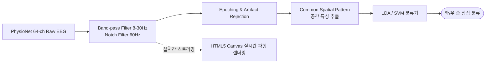

<!--
====================================================================
📌 [GitHub About 설정 가이드]
- Description: 실시간 뇌-컴퓨터 인터페이스(BCI) 모터 이미저리 분류 및 웹 캔버스 신호 시각화 대시보드
- Website: (배포 URL이 있다면 입력)
- Topics: bci, eeg, motor-imagery, mne-python, machine-learning, canvas, signal-processing, neuroscience
====================================================================
-->

# 🧠 BCI Motor Imagery Pipeline & Real-Time Web Visualizer

<p align="center">
  
  
  
  
</p>

> **PhysioNet 64채널 EEG 뇌파 기반 좌·우 손 상상 모터 이미저리(Motor Imagery) 분류 모델과 웹 브라우저 실시간 생체신호 시각화 대시보드**  
> 신호 전처리(Filtering), CSP 공간 패턴 추출, 머신러닝 분류기, 그리고 60FPS 브라우저 Canvas 렌더링 파이프라인을 엔드투엔드로 구축했습니다.

---

## 📌 Key Highlights

- **생체 신호 데이터 파이프라인**: PhysioNet 64채널 EEG Motor Movement/Imagery 데이터를 활용한 좌/우 손 운동 상상 2-Class 분류 시스템 구축.
- **주파수 대역 및 공간 필터링**: 
  - 8–30Hz 대역 통과 필터(Band-pass) 및 60Hz 노치 필터(Notch Filter)로 전원 노이즈 제거
  - 운동 피질 영역의 $\mu$(Mu) 및 $\beta$(Beta) 리듬 PSD(Power Spectral Density) 분석
  - CSP(Common Spatial Pattern) 알고리즘으로 공간적 특성 벡터 추출
- **분류 모델 검증**: LDA(선형판별분석) 및 SVM(서포트벡터머신) 모델을 교차 검증하여 최적의 분류 성능 달성.
- **실시간 웹 캔버스 시각화 (`eeg-visualizer`)**: 브라우저 Canvas API를 활용하여 뇌파 시계열 파형을 지연 없이 실시간 렌더링하고 모터 이미저리 예측 결과를 인터랙티브하게 표시.

---

## 🏗️ Signal Processing & Classification Flow



---

## 🛠 Tech Stack

| 구분 | 기술 스택 |
| :--- | :--- |
| **신호 처리 & 분석** | Python, MNE-Python, NumPy, SciPy |
| **머신러닝** | Scikit-learn (LDA, Support Vector Machine) |
| **웹 시각화** | JavaScript (ES6+), HTML5 Canvas API, CSS3 |

---

## 🚀 Getting Started

### 1. Repository Clone
```bash
git clone https://github.com/yj2da/eeg-visualizer.git
cd eeg-visualizer
```

### 2. 신호 처리 및 모델 학습 환경
```bash
pip install -r requirements.txt
python train_bci_model.py
```

### 3. 실시간 웹 시각화 대시보드 실행
```bash
# 로컬 웹 서버 실행 (Live Server or Python Simple HTTP)
python -m http.server 8000
# 브라우저에서 http://localhost:8000 접속
```

---

## 👩‍💻 Author
* **오예진 (Oh Yejin)** - AI & Data Specialist  
* Email: [yejin.6642@gmail.com](mailto:yejin.6642@gmail.com) | GitHub: [@yj2da](https://github.com/yj2da)
